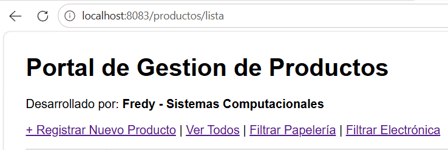
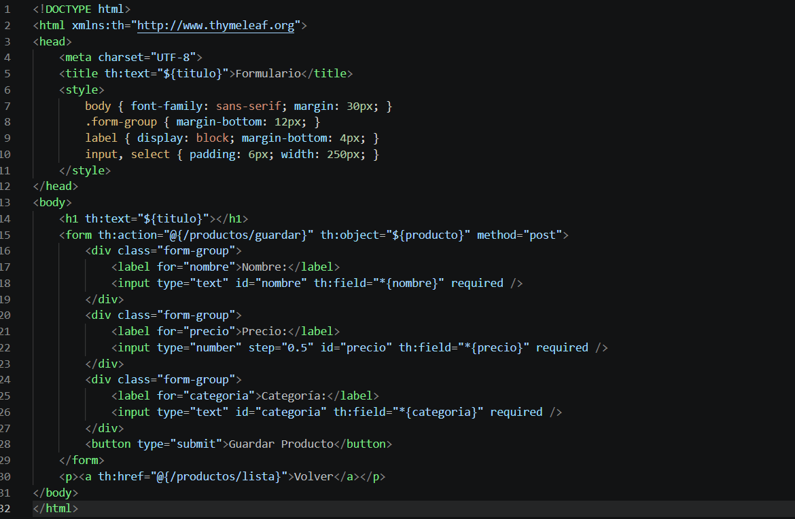
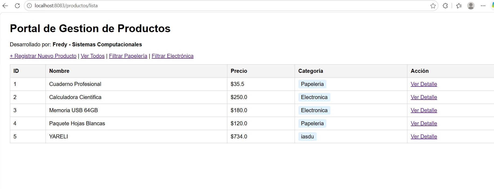
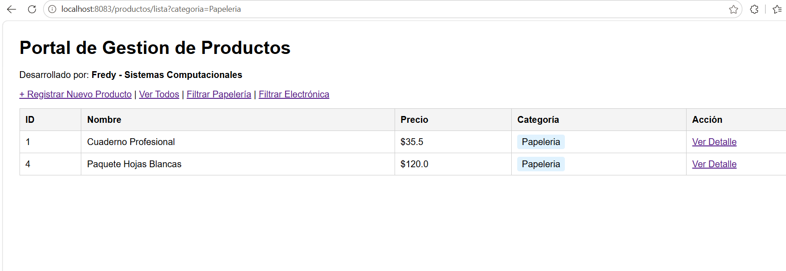
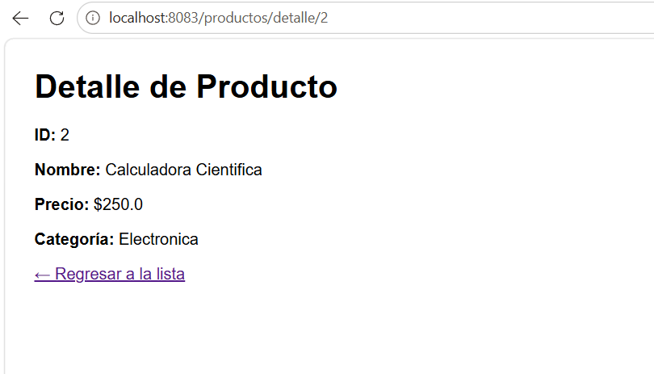
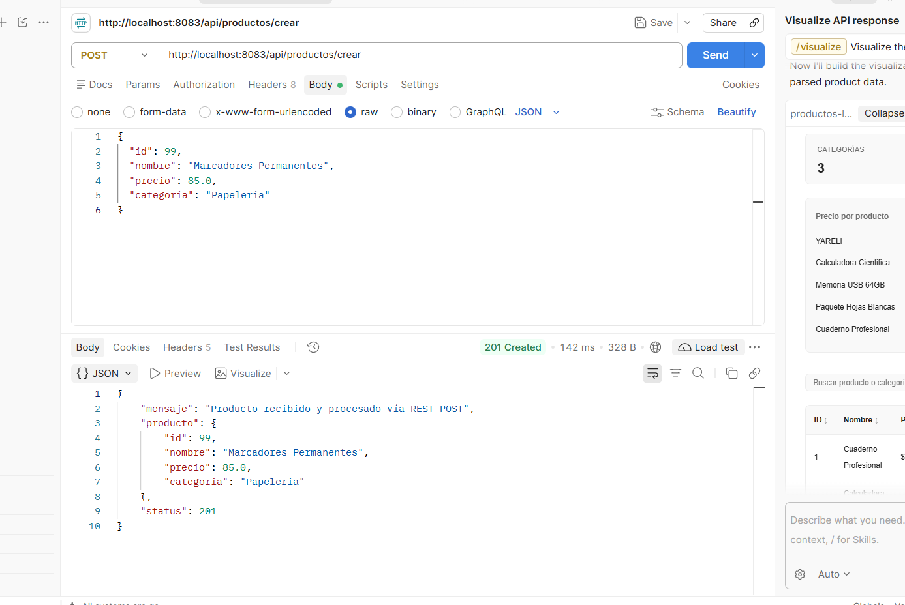

# Actividad 2 - Tema 4: Arquitectura MVC, Thymeleaf, DTOs y Servicios REST

Proyecto desarrollado con Spring Boot que implementa el patrón Modelo-Vista-Controlador (MVC) utilizando Thymeleaf para el renderizado del lado del servidor, estructuración de datos con clases DTO, captura de parámetros mediante anotaciones de Spring (`@RequestParam`, `@PathVariable`, `@ModelAttribute`), configuración externa con `@Value`, y procesamiento de peticiones HTTP POST con endpoints REST.

---

## 1. Tecnologías y Herramientas

- **Lenguaje:** Java 21
- **Framework:** Spring Boot (Spring Web, Spring Boot DevTools, Thymeleaf)
- **Gestor de Dependencias:** Apache Maven
- **Cliente HTTP para Pruebas:** Postman / Bruno
- **Entorno de Despliegue:** VPS Ubuntu Linux corriendo en segundo plano (`nohup`)

---

## 2. Estructura de Endpoints y Vistas

### Vistas Thymeleaf (Controlador MVC: `ProductoMvcController`)
- **`GET /productos/lista`**: Despliega el catálogo completo de productos recorridos dinámicamente con `th:each` e inyecta propiedades externas mediante `@Value`.
- **`GET /productos/lista?categoria={categoria}`**: Filtra el catálogo por categoría mediante `@RequestParam`.
- **`GET /productos/detalle/{id}`**: Muestra la información específica de un producto consultado por su identificador dinámico usando `@PathVariable`.
- **`GET /productos/nuevo`**: Renderiza el formulario de alta de productos vinculado a un objeto `ProductoDTO`.
- **`POST /productos/guardar`**: Procesa la información enviada desde el formulario enlazando los campos con `@ModelAttribute`.

### Servicio REST (Controlador REST: `ProductoRestController`)
- **`POST /api/productos/crear`**: Endpoint tipo REST que recibe un objeto JSON en el cuerpo de la petición (`@RequestBody`), lo deserializa en un `ProductoDTO` y responde con un objeto JSON y estado HTTP 201 Created.

---

## 3. Evidencia y Documentación Gráfica

### 3.1. Vista con el Listado de Productos (`th:each` y `@Value`)
Renderizado de la lista dinámica de productos utilizando la directiva `th:each` de Thymeleaf y mostrando los valores configurados en `application.properties` mediante `@Value`.

---

### 3.2. Formulario de Captura y Procesamiento (`@ModelAttribute`)
Formulario HTML enlazado al DTO y vista de confirmación que muestra los datos capturados y procesados a través de `@ModelAttribute`.

---

### 3.3. Filtrado por Parámetro de Consulta (`@RequestParam`)
Petición al listado filtrando únicamente los productos de una categoría específica (ej. `?categoria=Papeleria`).

---

### 3.4. Consulta por Variable de Ruta (`@PathVariable`)
Consulta del detalle de un producto específico mediante su ID en la URL (ej. `/productos/detalle/2`).

---

### 3.5. Prueba de Petición POST REST (Postman / Bruno)
Petición `POST` enviando un payload JSON hacia el endpoint `/api/productos/crear`, validando la recepción y respuesta adecuada con código 201 Created.

---

## 4. Despliegue en el Servidor VPS

Ambas actividades se encuentran desplegadas y corriendo de forma concurrente e independiente en el servidor:

- **URL para el POST en postman:**  
  `http://localhost:8083/api/productos/crear`

- **Actividad 2 (Puerto 8083):**  
  `http://179.197.84.73:8083/productos/lista`
- **Actividad 1 (Instancia activa en Puerto 8081):**  
  `http://179.197.84.73:8081/api/info/proyecto`